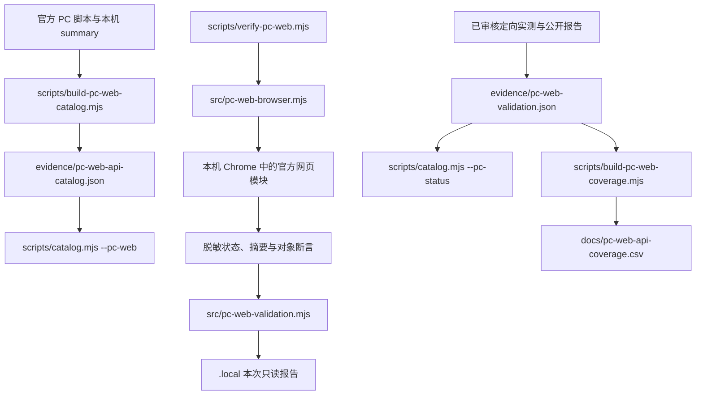
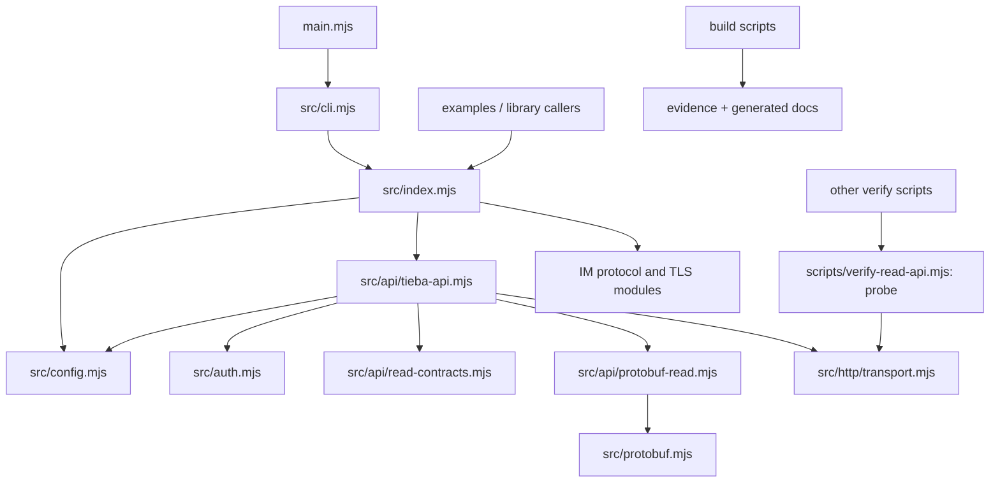

# 项目架构

项目以 PC 网页源码清单、只读验收和脱敏证据为当前入口，保留早期 App 客户端、APK 与 IM 研究模块。网页业务已实测的能力不自动成为可调用 SDK；两条协议链路不共享可用性结论。

## PC 网页工具结构

图为代码与证据流向示意。只读报告先写入本地新文件，审核后才纳入公开汇总；不是每次运行都自动覆盖公开证据。

| 模块 | 职责与边界 |
| --- | --- |
| PC 清单构建器 | 检查脚本大小和 SHA-256，提取字面量请求及紧邻 DataType，不执行源码 |
| 本机 CDP 连接 | 仅连接明确的回环调试端口，选择官方首页/论坛页；有连接及命令时限、最多 16 个待处理命令 |
| 网页读取入口 | 固定只读白名单，复用官方请求封装；原始响应和登录凭据留在浏览器内 |
| 结果分级 | 区分缺失/冲突业务状态、业务错误、对象匹配、结构返回和空分支 |
| 覆盖生成器 | 从已审核公开报告重建 CSV；不发请求、不把静态发现当通过 |

只读入口结束时恢复本次网页观察钩子、关闭 CDP 连接并释放计时器，不关闭 Chrome 或退出账号。详细输入、退出码和输出限制见 [PC 指南](pc-web-validation.md)。点赞、回复和收藏的定向写入流程有独立 [基础功能证据](pc-web-basic-functions.md)，签到、搜索与主帖也有 [独立验收](pc-web-sign-search-publish.md)；这些新增定向流程尚未封装为上述只读入口或通用 SDK。

## 历史 App 客户端结构

早期 App 客户端将“独立验证脚本 + 协议基础模块”整理为可复用客户端，同时保留证据与研究工具的独立职责。目标是让使用者可以直接调用已实现的能力，让开发者继续按明确契约扩展接口；历史实测成功不自动变成通用方法。

## 分层与依赖

图为保留的 App 客户端代码依赖示意，不是抓包或运行截图。

| 层 | 文件 | 负责什么 |
| --- | --- | --- |
| 用户入口 | `main.mjs`, `src/cli.mjs` | 参数分发、明确联网、预留新输出文件及退出码 |
| 业务客户端 | `src/api/tieba-api.mjs` | 10 个读取、2 个写入方法，输入校验、错误分层与对象核对 |
| 协议适配 | `src/api/read-contracts.mjs`, `protobuf-read.mjs` | 已核对字段、multipart 请求、响应白名单投影 |
| 认证与配置 | `src/auth.mjs`, `src/config.mjs` | 读取已有凭据、配置相对路径、协议常量及容量/时限 |
| HTTP 传输 | `src/http/transport.mjs` | 总超时、响应上限、取消、连接信息与响应摘要 |
| 基础协议 | `src/protobuf.mjs`, `legacy-signature.mjs`, `media-envelope.mjs` | 字节编解码、特定签名和已观察媒体前缀 |
| IM 连接 | `src/im-protocol.mjs`, `src/im-lcp-client.mjs` | LCP 帧、IM 签名、TLS、心跳及关闭 |
| 研究与验证 | `scripts/`, `tests/` | APK 提取、明确的复测计划、离线回归与证据投影 |
| 证据与文档 | `evidence/`, `docs/` | 脱敏的来源、历史观察、功能状态和使用说明 |

业务代码依赖传输模块，不再从可执行验证脚本导入网络实现。原 `scripts/verify-read-api.mjs` 继续导出 `probe` 并保留直接运行的诊断行为，旧脚本不需要统一改路径。提取前后的连接、超时、大小上限及重定向行为由已有测试与新增取消测试覆盖。

## 读取调用经过哪些步骤

1. 客户端校验名称、编号和分页参数，64 位编号保持精确字符串。
2. 按单个契约构造请求，将可选的本机认证字段放入公共数据。
3. HTTP 层执行一次请求，设置总时限与响应上限；`AbortSignal` 传递到连接。
4. 分别检查传输、HTTP、明确的业务状态与数据封装。
5. 按已选字段投影，核对请求对象，向调用方返回业务对象和摘要。
6. CLI 将结果写入预先创建的新文件；模块调用不自动落盘。

读取使用对应契约的最小 Protobuf 请求；GetTails/GetPrivateInfo 显式指定相反的 data/error 标签。两项新增写入使用 APK 已恢复的遗留签名表单，只有明确业务码 0 才返回 acknowledged。遗留 MD5 和 IM 签名属于各自明确恢复的协议，不将另一协议的签名或认证状态套用于当前路径。

错误包含阶段与业务码，不包含原始响应片段。认证对象的 JSON 与调试显示不展开凭据；公开资料响应中的认证字段不在投影白名单内。当前认证对象记录“已配置凭据”，不宣称服务器已验证会话。

## 兼容性和范围

- 既有 `node scripts/...` 入口及本地账号字段继续可用。
- `src/index.mjs` 为新增模块入口，`package.json` 提供本地自引用导出，当前不发布 npm 包。
- 默认 CLI 离线帮助；库的网络方法由调用方显式调用。
- 所有旧证据和逐项候选保留原有路径。客户端实测单列为 `evidence/client-validation.json`，未混入旧阶段请求总数。
- 没有数据库、账号格式迁移或自动后台任务。IM 连接由调用者显式创建并关闭。
- 本次没有把未验证路径生成成 API 方法；部分已测写入仍只在研究报告或定向工具中。

## 扩展接口

新增 App 业务方法前先确认 APK 来源、输入语义、格式、认证要求和真实响应。PC 扩展则以对应网页脚本和浏览器行为为依据，步骤见 [开发指南](development.md#扩展-pc-网页能力)。按相应模块添加契约与字段，不根据路径前缀判断读写。

读取方法需要覆盖身份或对象不匹配、业务错误、空数据及字段异常；有外部状态影响的业务还需要受控对象、基线、清理和回查。实现、测试及接口文档同步进入任务分支。静态发现、收到 HTTP 返回和业务验收是不同状态，覆盖清单继续分别记录。

## 参考来源

参考基线为 [cv-cat/DouYin_Spider 的 d151f9c 提交](https://github.com/cv-cat/DouYin_Spider/tree/d151f9c2980abc304c1ae4918c2272675cd9e4c2)。已阅读其 README、主入口和配置样例，并检查 API 与认证模块的相关片段及目录：

| 参考对象 | 本项目采用的组织方式 |
| --- | --- |
| [README](https://github.com/cv-cat/DouYin_Spider/blob/d151f9c2980abc304c1ae4918c2272675cd9e4c2/README.md) | 先展示能力，再给环境、配置和运行入口，专题细节由文档链接承载 |
| [dy_apis/douyin_api.py](https://github.com/cv-cat/DouYin_Spider/blob/d151f9c2980abc304c1ae4918c2272675cd9e4c2/dy_apis/douyin_api.py) | 提供可复用 API 类；本项目使用 `TiebaApi` 与独立契约文件 |
| [builder/auth.py](https://github.com/cv-cat/DouYin_Spider/blob/d151f9c2980abc304c1ae4918c2272675cd9e4c2/builder/auth.py) | 认证集中在对象中复用；本项目按实际需求读取已有本地登录态 |
| [main.py](https://github.com/cv-cat/DouYin_Spider/blob/d151f9c2980abc304c1ae4918c2272675cd9e4c2/main.py) | 运行编排与 API 类分开；本项目采用 Node CLI 与独立示例 |
| [.env.example](https://github.com/cv-cat/DouYin_Spider/blob/d151f9c2980abc304c1ae4918c2272675cd9e4c2/.env.example) | 提供可审查的配置入口；本项目使用无第三方依赖的 JSON 配置 |

本次按分层职责编写新的 JavaScript 实现，未迁移抖音接口、签名算法或平台返回结论。贴吧字段的依据是本仓库记录的 APK、协议元数据与真实响应，详见 [开发指南](development.md) 和 [客户端验证摘要](../evidence/client-validation.json)。
